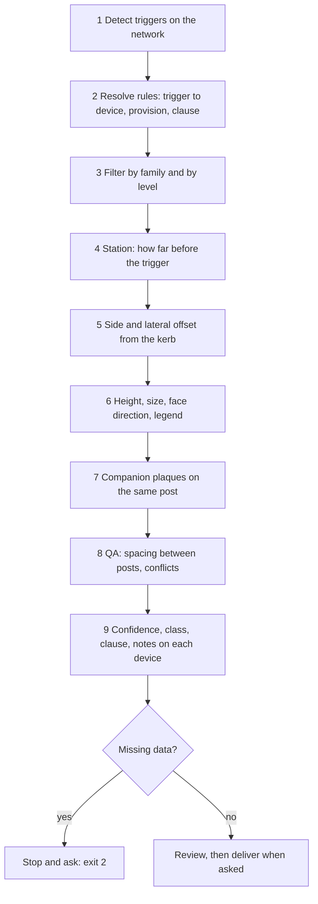

# Sign placement: workflow and rules (MUTCD 11th Edition rulebook)

**Status: DRAFT.** Rulebook `mutcd_11e` is `status: extracting`: no T&I engineer has signed it off, so everything here and everything the engine produces from it is DRAFT.
This page describes what the engine in `signs-skill/engine/` actually does (`triggers.py`, `placement.py`, `rulebook.py`) and the values in `rulebooks/mutcd_11e/`. It adds no value of its own.

**Scope.** MUTCD values only. **Egyptian (Code 104, Part 2) and SHC placement rules are not written here**: they must be read from their own sources with their own clause numbers. Never carry a MUTCD distance, offset or height into an Egyptian or SHC rulebook (build spec rule 6).
Units: the MUTCD tables are in feet and mph; the engine converts (1 ft = 0.3048 m; speeds in km/h, rounded AASHTO-style).

## 1. Workflow

| Step | What happens | Where in the code |
|---|---|---|
| 1 Detect | Intersections (3+ legs, excluding split/merge nodes of one-way carriageways), curves (total deflection ≥ 8°, radius ≤ 1,500 m, no single vertex turn > 45°), roundabouts, speed-zone changes, hazards (designer points), dead ends, school zones, grade crossings, lane drops, merges, divided-highway begin/end, one-way crossings, mid-block crossings, links to mark. | `triggers.py` |
| 2 Resolve | Each trigger picks the rules written for it (section 6). The code's word becomes the class: Standard = Mandatory, Guidance = Recommended, Option = Optional, Study = Conditional. A rule may change its provision by condition (`provision_if`, first match wins). | `rulebook.py`, `rules.yaml` |
| 3 Filter | Keep only the families selected (regulatory, warning, markings, delineators). Keep only the level selected: *mand* = Mandatory + Conditional; *rec* adds Recommended; *opt* adds Optional. A companion below the level is not placed and is logged. | `run.py` |
| 4 Station | Distance before the trigger along the approach (section 2). | `placement.py` |
| 5 Side and offset | Which side of the carriageway and how far from the kerb (section 3). | `placement.py` |
| 6 Height, size, face | Mounting height, sign size for the road class, the face points at oncoming traffic, legend filled from context (section 4). | `placement.py` |
| 7 Companions | Plaques (for example W13-1P advisory speed, R1-3P ALL WAY) share the post and raise the sign bottom. | `placement.py` |
| 8 QA | Minimum spacing between separate posts; conflicts such as STOP and YIELD at one intersection (section 5). | `placement.py` |
| 9 Record | Every device keeps rule id, trigger, clause, class, provision, confidence and notes. | `Device` |

If a value the rules need is missing (speed, class, lanes, one-way, urban or rural, AADT, control type, roundabout radius, hazard attributes), the run stops with exit 2 and asks. Nothing is filled in silently.

## 2. Station: how far before the trigger

The engine measures along the approach centreline, back from the trigger point (the stop line, the start of a curve, the hazard, the speed-zone change).

| Placement kind | Rule | Used for |
|---|---|---|
| `at_stop_line` | Distance back = **intersected road's half-width + 1.2 m** (4 ft minimum, 3B.19), **+ 3.0 m** if there is a crosswalk, never more than **half-width + 9.1 m** (30 ft). With drawn kerb lines, the sign is slid upstream, in 0.5 m steps and up to **half-width + 15.2 m** (about 50 ft, 2B.18), to the first point where the kerb is straight (at least 75% of the nominal half-width out, and within 0.3 m over the next 5 m). If none is found the device is **Low** confidence: "check position on plan". | STOP, YIELD, roundabout YIELD |
| `advance` | Distance = Table 2C-3 value (below) **added to** the trigger's own back distance. Condition A or B is set by the rule. | Stop/Yield/Signal Ahead, curve signs, lane ends, hazards |
| `along_curve` | Outside of the curve, from the start of the curve (PC) back toward the end (PT) at the spacing of Table 2C-5 (below); at least 2 devices. | Chevrons (W1-8), delineators |
| `curve_outside` | One sign on the outside of the curve, in line with approaching traffic, at **min(½ of the curve length, ½ of the radius)** before the PC (2C.10-04). Medium confidence. | One-direction large arrow (W1-6) |
| `at_point` | At the trigger. If the speed-zone change falls at an intersection, the new limit is posted **half-width + 30 m beyond** the intersection (2B.21). | Speed limit, dead end, no-passing pennant |
| `downstream` | The rule's own distance: **15 m inside** a site boundary (entry speed limit, 2B.21), **60 m beyond** a major intersection (speed reminder, 2B.21-17). | Site entry speed, speed reminder |
| `at_node_facing_cross` | Near-right corner at **max(½ crossing width + 1.5 m, 3 m)** from the node and the far-left corner **½ width + 3 m** beyond it; the arrow points along the one-way flow (2B.49). Low confidence: adjust on plan. | ONE WAY at one-way crossings |
| `at_exit_end` | **Half-width + 3.0 m** from the node along the exit link, both sides, facing traffic that would enter against the flow (2B.46). Medium confidence. | DO NOT ENTER |

### 2.1 Advance placement, Table 2C-3 (MUTCD 11th Ed., manual p.152)

Lookup: the **posted speed is rounded up** to the next table row (conservative). For Condition B the **advisory speed is rounded down** to the column (conservative). An N/A cell gives **100 ft (30.48 m)** (note 5/6: place to site conditions, at least 100 ft between signs).

Condition A (speed reduction and lane changing in heavy traffic) and Condition B for a potential stop (b0):

| Posted speed (mph) | km/h (approx.) | Cond. A (ft) | Cond. A (m) | Cond. B, potential stop (ft) | Cond. B stop (m) |
|---:|---:|---:|---:|---:|---:|
| 20 | 32 | 225 | 69 | 115 | 35 |
| 25 | 40 | 325 | 99 | 155 | 47 |
| 30 | 48 | 460 | 140 | 200 | 61 |
| 35 | 56 | 565 | 172 | 250 | 76 |
| 40 | 64 | 670 | 204 | 305 | 93 |
| 45 | 72 | 775 | 236 | 360 | 110 |
| 50 | 80 | 885 | 270 | 425 | 130 |
| 55 | 88 | 990 | 302 | 495 | 151 |
| 60 | 97 | 1100 | 335 | 570 | 174 |
| 65 | 105 | 1200 | 366 | 645 | 197 |
| 70 | 113 | 1250 | 381 | 730 | 223 |
| 75 | 121 | 1350 | 411 | 820 | 250 |
| 80 | 129 | 1475 | 450 | 910 | 277 |
| 85 | 137 | 1600 | 488 | 1010 | 308 |

Condition B by advisory speed (feet; blank in the source = N/A = 100 ft):

| Posted mph \ advisory mph | 10 | 20 | 30 | 40 | 50 | 60 | 70 | 80 |
|---:|---:|---:|---:|---:|---:|---:|---:|---:|
| 40 | 100 | 100 | N/A | N/A | N/A | N/A | N/A | N/A |
| 45 | 125 | 100 | 100 | N/A | N/A | N/A | N/A | N/A |
| 50 | 200 | 175 | 125 | 100 | N/A | N/A | N/A | N/A |
| 55 | 275 | 225 | 200 | 125 | N/A | N/A | N/A | N/A |
| 60 | 350 | 325 | 275 | 200 | 100 | N/A | N/A | N/A |
| 65 | 450 | 400 | 350 | 275 | 200 | 100 | N/A | N/A |
| 70 | 525 | 500 | 450 | 375 | 275 | 150 | N/A | N/A |
| 75 | 625 | 600 | 550 | 475 | 375 | 250 | 100 | N/A |
| 80 | 725 | 700 | 625 | 550 | 450 | 350 | 200 | N/A |
| 85 | 825 | 800 | 750 | 675 | 575 | 450 | 300 | 150 |

Hazard signs use **Condition B**: the point's `advisory_kmh` when given, otherwise the potential-stop column. This is an engine assumption (2C.04-03: apply with judgment); say so in every report.

### 2.2 Curves

Curve signs follow Table 2C-4. Chart A (roadway type and AADT) decides whether a device is required; Chart B decides which, by the speed differential between the posted (or 85th percentile) speed and the advisory speed:

| Speed differential (mph) | Devices |
|---:|---|
| ≥ 5 | markings or sign |
| ≥ 10 | sign |
| ≥ 15 | sign + delineators |
| ≥ 20 | sign + chevrons |

The advisory speed is a geometry estimate (FHWA ball-bank approximation, friction 0.21, 0.18, 0.15; rounded down to 10 km/h; floored at 10 km/h). **Confirm it with a ball-bank or GPS study before issue.** Medium confidence.

Chevron and delineator spacing, Table 2C-5 (MUTCD 11th Ed., manual p.158); the metric bands pair with the mph bands AASHTO-style:

| Advisory speed up to (km/h) | (mph) | Spacing (ft) | Spacing (m) |
|---:|---:|---:|---:|
| 20 | 15 | 40 | 12.2 |
| 50 | 30 | 80 | 24.4 |
| 70 | 45 | 120 | 36.6 |
| 100 | 60 | 160 | 48.8 |
| any | any | 200 | 61.0 |

## 3. Side and lateral offset

| Item | Rule |
|---|---|
| Side | Set by each rule: `right` (default), `left`, `both`, or `outside` (the outside of a curve: right of the road when the curve turns left, left when it turns right). Right-hand traffic is the default (Egypt). With `drive = left` the sides swap. |
| Offset, kerb drawn | **Distance to the outermost kerb or edge line on that side** (within the nominal half-width + 3.5 m + shoulder), **plus the mounting offset** below. The outermost line is used so that a splitter-island edge or a parking-bay line is passed over. |
| Offset, no kerb | Nominal half-width (lanes x lane width) + shoulder + mounting offset. The device notes it, and a drawing with kerb lines but no hit on this side says "no kerb line found: nominal offset used". |
| Nominal half-width | Two-way road: lanes per direction x lane width, for a sign on either side. One-way road: half of (lanes x lane width), either side. Lane width defaults to **3.65 m** when the data has none; say so in the report. |

## 4. Height, size, face, legend

Mounting, MUTCD 2A.15 (height) and 2A.16 (lateral offset); verified from the T&I copy of the PDF on 30 Sep 2026:

| Context | Min. height to sign bottom | Lateral offset | Measured from | Clause |
|---|---|---|---|---|
| rural | 5 ft (1.52 m) | 12 ft (3.66 m) | edge of traveled way | 2A.15-04 / 2A.16-03 |
| urban | 7 ft (2.13 m) | 2 ft (0.61 m) | face of curb | 2A.15-05 / T&I default 2 ft; code minimum 1 ft (2A.16-10) |
| freeway | 7 ft (2.13 m) | 12 ft (3.66 m) | edge of traveled way | 2A.15-11 / 2A.16-03 |

- A plaque on the same post raises the sign bottom by the plaque height + 0.05 m (2A.15).
- The T&I fixation detail shows 2.10 m to the sign bottom; the MUTCD urban minimum is 2.13 m. The engine logs this whenever the run's heights exceed the detail.
- **Size**: freeway and expressway sizes by road class; otherwise the multi-lane size for roads with 2+ lanes per direction, the single-lane size below that. The size setting can force one.
- **Face**: the sign face points at oncoming traffic (azimuth = approach heading + 180°).
- **Legend**: an explicit legend wins; otherwise the catalogue template (`{speed}` is filled from the new or posted speed in km/h; advisory speeds are floored to 10 km/h steps).
- **Orientation** (left/right) is taken from the trigger; where it cannot be known the device says "CONFIRM left/right" or "CONFIRM which lane ends".

## 5. QA after placement

| Check | Rule |
|---|---|
| Spacing | Between **separate posts** on one approach and one side, keep **100 ft (30.48 m)** (Table 2C-3 note 6). Devices are ordered by distance back, then by priority: regulatory, then school, then warning. A lower-priority sign moves **upstream** by the shortfall; every move is logged on the device. Chevrons, delineators, signs fixed at the stop line, node or exit end, and a repeat of the same code within 1 m are not moved. |
| Confidence after a move | High becomes Medium. If the approach is too short for the distance, the sign goes at the start of the approach and the device is Low. |
| Conflicts | STOP and YIELD at the same intersection (2B.06-09: not on conflicting approaches). STOP or YIELD at a signalised node (2B.06-08). Both are reported, not fixed. |

Confidence: **High** = placed by rule and geometry. **Medium** = depends on an estimate (advisory speed, spacing moved, chevrons, curve arrow). **Low** = the engine could not place it reliably (no straight kerb, short approach, corner positions): place by hand.

## 6. The rules in the rulebook (81; 27 checked, 54 unverified)

"Unverified" means the rule text has not yet been confirmed by T&I against the printed manual; it still runs, and its output stays DRAFT.

### 6.1 Intersection control and advance warning

| Rule | Trigger | Device | Provision | Placement | Status |
|---|---|---|---|---|---|
| `2B.04.ALLWAY` | INT-STOP-AWAY | R1-1 | Standard | at_stop_line / right | checked |
| `2B.18.STOP` | INT-STOP-2WAY | R1-1 | Standard | at_stop_line / right | checked |
| `2B.18.STOP-LEFT` | INT-STOP-2WAY, INT-STOP-AWAY | R1-1 | Option | at_stop_line / left | checked |
| `3B.19.STOPLINE` | INT-STOP-2WAY, INT-STOP-AWAY, INT-SIGNAL | SL | Guidance | stop_line / - | checked |
| `2C.35.STOPAHEAD` | INT-STOP-2WAY, INT-STOP-AWAY | W3-1 | Study (class varies) | advance / right | checked |
| `2B.10.YIELD` | INT-YIELD | R1-2 | Standard | at_stop_line / right | checked |
| `3B.19.YIELDLINE` | INT-YIELD, INT-ROUNDABOUT | YL | Option | stop_line / - | checked |
| `2C.35.YIELDAHEAD` | INT-YIELD | W3-2 | Study (class varies) | advance / right | checked |
| `2C.35.SIGNALAHEAD` | INT-SIGNAL | W3-3 | Study (class varies) | advance / right | checked |
| `2B.ROUNDABOUT.YIELD` | INT-ROUNDABOUT | R1-2 | Standard | at_stop_line / right | checked |
| `2C.ROUNDABOUT.W2-6` | INT-ROUNDABOUT | W2-6 | Option | advance / right | checked |
| `2C.41.INTWARN` | INT-UNCONTROLLED-MAJOR | (by site data) | Option | advance / right | checked |

STOP, YIELD and Signal Ahead are **Conditional** until sight is confirmed (`sight_restricted` true or false). Sight distance is not computed.

### 6.2 Curves

| Rule | Trigger | Device | Provision | Placement | Status |
|---|---|---|---|---|---|
| `2C.06.CURVE-SIGN` | CURVE | (by site data) | Guidance (class varies) | advance / right | checked |
| `2C.08.CHEVRONS` | CURVE | W1-8 | Guidance (class varies) | along_curve / outside | checked |
| `2C.06.DELINEATORS` | CURVE | DELINEATOR | Guidance (class varies) | along_curve / outside | checked |
| `2C.10.LARGE-ARROW` | CURVE | W1-6 | Option | curve_outside / - | unverified |

### 6.3 Speed limits

| Rule | Trigger | Device | Provision | Placement | Status |
|---|---|---|---|---|---|
| `2B.21.SPEED-CHANGE` | SPEED-ZONE | R2-1 | Standard | at_point / right | checked |
| `2B.21.SITE-ENTRY` | BOUNDARY-ENTRY | R2-1 | Standard | downstream / right | checked |
| `2C.40.REDUCED-AHEAD` | SPEED-ZONE | W3-5 | Guidance | advance / right | checked |
| `2B.21.SPEED-REMIND` | AFTER-MAJOR-INT | R2-1 | Guidance | downstream / right | checked |

### 6.4 One-way, lanes, divided roads, merges

| Rule | Trigger | Device | Provision | Placement | Status |
|---|---|---|---|---|---|
| `2B.49.ONEWAY` | ONE-WAY-CROSSING | R6-1 | Standard | at_node_facing_cross / both_far | unverified |
| `2B.46.DONOTENTER` | ONE-WAY-EXIT | R5-1 | Standard | at_exit_end / both | checked |
| `2C.47.LANE-ENDS` | LANE-DROP | W4-2 | Guidance | advance / right | checked |
| `3B.12.LANE-REDUCTION` | LANE-DROP | LDRP | Standard | taper / - | checked |
| `2C.20.DIVIDED-HIGHWAY` | DIVIDED-BEGIN | W6-1 | Guidance | advance / right | unverified |
| `2B.39.KEEP-RIGHT-NOSE` | DIVIDED-BEGIN | R4-7 | Option | at_point / left | unverified |
| `2C.21.DIVIDED-ENDS` | DIVIDED-END | W6-2 | Guidance | advance / right | unverified |
| `2C.51.TWO-WAY-TRAFFIC` | DIVIDED-END | W6-3 | Guidance | at_point / right | unverified |
| `2C.51.ONEWAY-TO-TWOWAY` | ONEWAY-TO-TWOWAY | W6-3 | Guidance | advance / right | unverified |
| `2C.45.MERGE-MAJOR` | MERGE | W4-1 | Option (class varies) | advance / {t['merge_side']} | unverified |
| `2C.45.MERGE-ENTERING` | MERGE | W4-1 | Option (class varies) | advance / right | unverified |
| `2C.46.ADDED-LANE-MAJOR` | ADDED-LANE | W4-3 | Guidance | advance / {t['merge_side']} | unverified |
| `2C.46.ADDED-LANE-ENTERING` | ADDED-LANE | W4-3 | Study | advance / right | unverified |

### 6.5 Pedestrians, school, crosswalks

| Rule | Trigger | Device | Provision | Placement | Status |
|---|---|---|---|---|---|
| `3C.02.CROSSWALK-SIGNAL` | INT-SIGNAL | CW | Guidance | crosswalk / - | checked |
| `3C.02.CROSSWALK-MIDBLOCK` | PED-XING-MIDBLOCK | CW | Standard | crosswalk / - | checked |
| `2C.55.PED-ADVANCE` | PED-XING-MIDBLOCK | W11-2 | Option | advance / right | unverified |
| `2C.55.PED-AT-CROSSWALK` | PED-XING-MIDBLOCK | W11-2 | Option | at_point / right | unverified |
| `7B.SCHOOL-ADVANCE` | SCHOOL | S1-1 | Study (class varies) | advance / right | checked |

### 6.6 Grade crossings

| Rule | Trigger | Device | Provision | Placement | Status |
|---|---|---|---|---|---|
| `8B.06.W10-1` | HAZ-RAIL_CROSSING | W10-1 | Standard | advance / right | unverified |
| `8B.06.W10-1-LEFT` | HAZ-RAIL_CROSSING | W10-1 | Option | advance / left | unverified |
| `8B.03.CROSSBUCK` | HAZ-RAIL_CROSSING | R15-1 | Standard | at_point / right | unverified |
| `8C.02.RXR` | HAZ-RAIL_CROSSING | RXR | Option (class varies) | lane_symbol / - | unverified |

W10-1 is **Mandatory on every approach**; the designer removes it by hand where an 8B.06-01 exception applies. The Crossbuck goes 4.6 m (15 ft) + half the track gauge before the track; confirm the railway's clearance.

### 6.7 Hazards (designer places a point of the hazard type; the engine asks for its attributes)

| Rule | Trigger | Device | Provision | Placement | Status |
|---|---|---|---|---|---|
| `2C.19.ONE-LANE-STRUCTURE` | HAZ-NARROW_STRUCTURE | (by site data) | Guidance | advance / right | unverified |
| `2C.18.NARROW-STRUCTURE` | HAZ-NARROW_STRUCTURE | (by site data) | Guidance | advance / right | unverified |
| `2C.17.ROAD-NARROWS` | HAZ-ROAD_NARROWS | W5-1 | Guidance (class varies) | advance / right | unverified |
| `2C.25.LOW-CLEARANCE` | HAZ-LOW_CLEARANCE | W12-2 | Standard | advance / right | unverified |
| `2C.27.SPEED-HUMP` | HAZ-SPEED_HUMP | W17-1 | Guidance | advance / right | unverified |
| `2C.26.BUMP` | HAZ-BUMP | W8-1 | Guidance | advance / right | unverified |
| `2C.26.DIP` | HAZ-DIP | W8-2 | Guidance | advance / right | unverified |
| `2C.28.PAVEMENT-ENDS` | HAZ-PAVEMENT_ENDS | W8-3 | Guidance | advance / right | unverified |
| `2C.14.HILL` | HAZ-DOWNGRADE | W7-1 | Study (class varies) | advance / right | unverified |
| `7B.04.SCHOOL-BUS-STOP` | HAZ-SCHOOL_BUS_STOP | S3-1 | Study (class varies) | advance / right | unverified |
| `2C.54.TRUCK` | HAZ-TRUCK_CROSSING | W11-10 | Option | advance / right | unverified |
| `2C.54.FARM` | HAZ-FARM_VEHICLES | W11-5 | Option | advance / right | unverified |
| `2C.54.BICYCLE` | HAZ-BICYCLE_CROSSING | W11-1 | Option | advance / right | unverified |
| `2C.54.EMERGENCY` | HAZ-EMERGENCY_STATION | W11-8 | Option (class varies) | advance / right | unverified |
| `2C.55.DEER` | HAZ-DEER_CROSSING | W11-3 | Option | advance / right | unverified |
| `2C.55.CATTLE` | HAZ-CATTLE_CROSSING | W11-4 | Option | advance / right | unverified |
| `2C.55.EQUESTRIAN` | HAZ-EQUESTRIAN_CROSSING | W11-7 | Option | advance / right | unverified |
| `2C.56.PLAYGROUND` | HAZ-PLAYGROUND | W15-1 | Option | advance / right | unverified |
| `2C.30.SLIPPERY` | HAZ-SLIPPERY | W8-5 | Option | advance / right | unverified |
| `2C.30.BRIDGE-ICES` | HAZ-BRIDGE_ICES | W8-13 | Option | advance / right | unverified |
| `2C.30.FALLEN-ROCKS` | HAZ-FALLEN_ROCKS | W8-14 | Option | advance / right | unverified |
| `2C.30.LOOSE-GRAVEL` | HAZ-LOOSE_GRAVEL | W8-7 | Option | advance / right | unverified |
| `2C.30.ROUGH-ROAD` | HAZ-ROUGH_ROAD | W8-8 | Option | advance / right | unverified |
| `2C.34.FLOOD` | HAZ-FLOODING | W8-18 | Option | advance / right | unverified |
| `2C.34.GUSTY-WINDS` | HAZ-GUSTY_WINDS | W8-21 | Option | advance / right | unverified |
| `2C.34.FOG` | HAZ-FOG | W8-22 | Option | advance / right | unverified |
| `2C.29.SOFT-SHOULDER` | HAZ-SOFT_SHOULDER | W8-4 | Option | advance / right | unverified |
| `2C.29.LOW-SHOULDER` | HAZ-LOW_SHOULDER | W8-9 | Option | advance / right | unverified |
| `2C.29.DROP-OFF` | HAZ-SHOULDER_DROPOFF | W8-17 | Guidance | advance / right | unverified |
| `2C.29.NO-SHOULDER` | HAZ-NO_SHOULDER | W8-23 | Option | advance / right | unverified |
| `2C.29.SHOULDER-ENDS` | HAZ-SHOULDER_ENDS | W8-25 | Option | advance / right | unverified |
| `2C.53.NO-PASSING-ZONE` | HAZ-NO_PASSING_START | W14-3 | Option | at_point / left | unverified |
| `2C.24.DEAD-END` | HAZ-DEAD_END | W14-1 | Option | at_point / right | unverified |
| `2C.24.NO-OUTLET` | HAZ-NO_OUTLET | W14-2 | Option | at_point / right | unverified |

### 6.8 Markings and designer-placed signs

| Rule | Trigger | Device | Provision | Placement | Status |
|---|---|---|---|---|---|
| `3B.02.CENTERLINE` | MARK-LINK | CL-DY | Option (class varies) | link_line / - | unverified |
| `3B.10.EDGELINE` | MARK-LINK | EL-SW | Option (class varies) | link_line / - | unverified |
| `3B.04.LANELINE` | MARK-LINK | LL-BW | Guidance (class varies) | link_line / - | checked |
| `3B.NOPASS` | MARK-LINK | NO-PASSING-STUDY | Study | link_note / - | checked |
| `CATALOG.SIGN-REQUEST` | SIGN-REQUEST | (by site data) | (by request) | at_point / right | unverified |

Marking placement: stop line across the approach width at the stop-line distance; crosswalk 3.0 m wide; lane-reduction taper **L = W x S / 1.6** for S ≥ 70 km/h, otherwise **W x S² / 155** (W = lane width in m, S = speed in km/h; 3B.12 in metric form); link lines are trimmed by the junction half-width + 1.2 m at each end; lane lines are painted for 25% of the length (10 ft line, 30 ft gap); the centre line pattern is double solid until a no-passing study is done.

## 7. Not automated

Place these by hand, or as designer points (`type: sign`, with `code`, `facing`, `legend`): ONE WAY and Keep Right at divided-highway crossings (2B.49-03 to 05), Yield Here To Pedestrians (2B.19), BEGIN and END ONE WAY, roundabout island signs, parking, W10-2/3/4 parallel-highway signs, W12-2a overhead clearance. Also not covered: guide signs (they need a destinations list), temporary traffic control, chevron and arrow **pavement** markings (TI-614 to TI-619, L13-1 to L13-6; waiting for T&I's rule).

## 8. Placing a sign by hand (same method, for a designer)

1. **Trigger.** Name what requires the sign (the control type at a node, a curve, a hazard, a speed change) and the rule id above.
2. **Device and class.** Take the code and class from the rule; note Conditional items as studies.
3. **Station.** Compute the distance back from the table in section 2; round the speed up and the advisory speed down; use 100 ft where the table says N/A.
4. **Side.** Right of the approaching traffic unless the rule says otherwise; on the outside for curves.
5. **Offset and height.** Kerb face + 2 ft (0.61 m) urban, edge of traveled way + 12 ft (3.66 m) rural or freeway; bottom at 7 ft (2.13 m) urban, 5 ft (1.52 m) rural; raise for plaques.
6. **Face.** Perpendicular to the approach, facing oncoming traffic.
7. **Spacing.** At least 100 ft (30.48 m) from the next post on that approach and side; move the lower-priority sign upstream.
8. **Conflicts.** No STOP with YIELD at one intersection; no STOP/YIELD at a signal.
9. **Record.** Clause, class, confidence, and what you assumed. Flag Low-confidence signs for the site check.

## 9. Open items for this page

- Egyptian and SHC placement rules: not written; waiting for their sources.
- 54 unverified MUTCD rules, advisory-speed friction values (FHWA-SA-11-22) and delineator spacing (Chapter 3G): engineer review.
- Chevron and arrow pavement markings: waiting for T&I's rule.
- Sight distance, which decides whether Stop/Yield/Signal Ahead are needed, is not computed.
